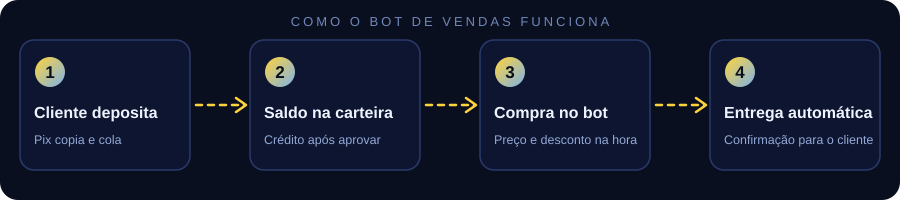
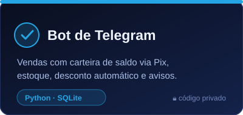
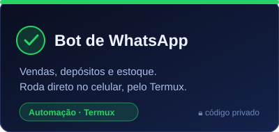
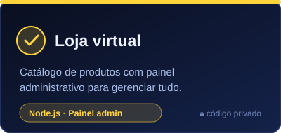

[Sobre](#sobre) · [O que eu desenvolvo](#o-que-eu-desenvolvo) · [Projetos](#projetos) · [Tecnologias](#tecnologias) · [Contato](#contato)

## Sobre

Sou o **LuizDev.Py**, programador brasileiro. Crio **bots de vendas e automações** que cuidam sozinhos do trabalho repetitivo: receber depósito, atualizar saldo, controlar estoque e entregar o pedido.

Gosto de projeto que roda direto, sem depender de servidor caro: meus bots funcionam no PC, no celular (Termux) ou em qualquer lugar com internet. Escolho a tecnologia pelo que o projeto precisa e priorizo código que dá para manter e atualizar sem perder dados.

  

## O que eu desenvolvo

| Área                      | Na prática                                                            |
|:--------------------------|:----------------------------------------------------------------------|
| **Bots de vendas**        | Telegram e WhatsApp com catálogo, carteira de saldo e pedidos.        |
| **Pagamentos**            | Depósito por Pix, confirmação e crédito automático na carteira.       |
| **Estoque e entrega**     | Controle de estoque e entrega automática do pedido ao cliente.        |
| **Painel do administrador** | Usuários, saldos, avisos em massa e controle de acesso pelo próprio bot. |
| **Descontos e regras**    | Promoções automáticas, por exemplo desconto por histórico de depósitos. |

## Projetos

Meus projetos de venda são **privados** (têm dados de compradores e integrações), então ficam fora do GitHub público. Aqui está um resumo do que eu mantenho:

  
  
  

## Tecnologias

| **Linguagens**       |      |
|:---------------------|:--|
| **Bots e backend**   |    |
| **Dados**            |  |
| **Ferramentas**      |     |

## Contato

Quer trocar uma ideia sobre bots e automação? Fale comigo.

| Canal         | Onde me encontrar                                          |
|:--------------|:-----------------------------------------------------------|
| **Telegram**  | [@SEU_USUARIO_TELEGRAM](https://t.me/luizdev_PY) |
| **WhatsApp**  | [Chamar no WhatsApp](https://wa.me/5584994568982)            |

---

**LuizDev.Py** · Bots & Automação · Brasil

